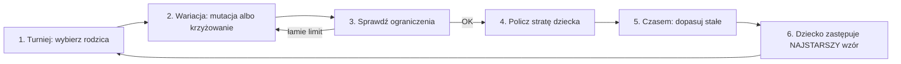

# Regresja symboliczna w C++ — wyjaśnienie od zera

Ten dokument jest dla osoby, która **pierwszy raz** widzi ten projekt i nie musi
nic wiedzieć o sztucznej inteligencji, algorytmach ewolucyjnych ani C++.
Czytaj po kolei — każdy rozdział korzysta z poprzedniego.

> Krótka wersja w jednym zdaniu: **dajemy programowi tabelkę z liczbami, a on
> sam zgaduje, jakim wzorem matematycznym te liczby zostały wygenerowane.**

---

## Spis treści

1. [Problem, który rozwiązujemy](#1-problem-który-rozwiązujemy)
2. [Czym to się różni od „zwykłego” uczenia maszynowego](#2-czym-to-się-różni-od-zwykłego-uczenia-maszynowego)
3. [Jak komputer „widzi” wzór — drzewo wyrażenia](#3-jak-komputer-widzi-wzór--drzewo-wyrażenia)
4. [Jak ocenić, czy wzór jest dobry — funkcja straty](#4-jak-ocenić-czy-wzór-jest-dobry--funkcja-straty)
5. [Jak szukać wzoru — ewolucja jak w biologii](#5-jak-szukać-wzoru--ewolucja-jak-w-biologii)
6. [Dopasowanie liczb we wzorze — optymalizacja stałych](#6-dopasowanie-liczb-we-wzorze--optymalizacja-stałych)
7. [Prosty czy dokładny? — hall of fame i front Pareta](#7-prosty-czy-dokładny--hall-of-fame-i-front-pareta)
8. [Dane: trening, walidacja, test](#8-dane-trening-walidacja-test)
9. [Temat etapu 23.11: konfigurowalność](#9-temat-etapu-2311-konfigurowalność)
10. [Temat etapu 23.11: ograniczenia](#10-temat-etapu-2311-ograniczenia)
11. [Co się dzieje, gdy wzór „wybucha” (dzielenie przez zero itp.)](#11-co-się-dzieje-gdy-wzór-wybucha)
12. [Testy — skąd wiemy, że to działa](#12-testy--skąd-wiemy-że-to-działa)
13. [Wyniki do tej pory](#13-wyniki-do-tej-pory)
14. [Mapa plików — co gdzie leży](#14-mapa-plików--co-gdzie-leży)
15. [Jak to uruchomić](#15-jak-to-uruchomić)
16. [Słowniczek](#16-słowniczek)
17. [Najczęstsze pytania prowadzącego (i odpowiedzi)](#17-najczęstsze-pytania-prowadzącego-i-odpowiedzi)

---

## 1. Problem, który rozwiązujemy

Wyobraź sobie, że jesteś fizykiem. Ciągniesz sprężynę i mierzysz:

| wydłużenie x [m] | siła F [N] |
|---|---|
| 0,0 | 0,75 |
| 1,0 | 3,25 |
| 2,0 | 5,75 |
| −1,0 | −1,75 |

Patrzysz na to i po chwili widzisz: „każdy metr dodaje 2,5 N, a na starcie jest
0,75 N”, czyli

$$F = 2{,}5 \cdot x + 0{,}75$$

**Regresja symboliczna** to program, który robi dokładnie to samo za człowieka:
dostaje tabelę (plik CSV), a zwraca **wzór** — czytelny, krótki, taki, który
można wpisać do zeszytu i zrozumieć.

Dlaczego to trudne? Bo program nie wie z góry:
- **jaki kształt** ma wzór (czy to dodawanie, mnożenie, cosinus, potęga…?),
- **jakie liczby** są w środku (2,5? 0,75? 9,81?).

Musi zgadnąć jedno i drugie jednocześnie. Możliwych wzorów jest nieskończenie wiele,
więc nie da się „sprawdzić wszystkich”. Trzeba szukać sprytnie.

Wzorujemy się na bibliotece **PySR** (Python/Julia), która jest znanym narzędziem
do tego zadania. My piszemy **własną** implementację w **C++23**, a pod koniec
semestru porównamy ją z PySR.

---

## 2. Czym to się różni od „zwykłego” uczenia maszynowego

Sieć neuronowa też może nauczyć się przewidywać siłę sprężyny. Ale w środku ma
tysiące liczb (wag), których człowiek nie rozumie — to **czarna skrzynka**.

| | Sieć neuronowa | Regresja symboliczna |
|---|---|---|
| Wynik | miliony wag | wzór, np. `2,5·x + 0,75` |
| Czy człowiek to rozumie? | nie | tak |
| Czy zadziała poza zakresem danych? | często źle | jeśli wzór jest prawdziwy — tak |
| Szybkość uczenia | szybko | wolniej (trzeba przeszukać wiele wzorów) |

W fizyce i inżynierii wzór jest cenniejszy niż czarna skrzynka, bo można go
sprawdzić, zrozumieć i opublikować.

---

## 3. Jak komputer „widzi” wzór — drzewo wyrażenia

Komputer nie widzi napisu `2,5·x + 0,75`. Zapisujemy wzór jako **drzewo**:

```text
        +
       / \
      *   0.75
     / \
   2.5  x
```

Czytamy od dołu: najpierw `2.5 * x`, potem do wyniku dodajemy `0.75`.

W drzewie są cztery rodzaje „klocków” (węzłów):

| Rodzaj | Przykład | Ile ma dzieci |
|---|---|---|
| **stała** (`constant`) | `2.5`, `0.75` | 0 (to liść) |
| **zmienna** (`variable`) | `x`, `t`, `v0` | 0 (to liść) |
| **operator jednoargumentowy** (`unary`) | `cos(…)`, `square(…)` | 1 |
| **operator dwuargumentowy** (`binary`) | `+`, `−`, `*`, `/`, `pow` | 2 |

Program potrafi wypisać takie drzewo (to wyjście z `sr_example`):

```text
binary: +
|-- binary: *
|   |-- constant: 2.5
|   `-- variable: x
`-- constant: 0.75
```

### Dlaczego drzewo?

Bo bardzo łatwo je **zmieniać**: można podmienić jeden liść, jedną gałąź, dokleić
nowy węzeł. To jest dokładnie to, czego potrzebuje algorytm ewolucyjny (rozdział 5).

### Złożoność wzoru

**Złożoność = liczba węzłów w drzewie.** Wzór powyżej ma 5 węzłów (`+`, `*`,
`2.5`, `x`, `0.75`), więc złożoność wynosi 5. Tak samo liczy PySR. Krótszy wzór =
prostszy wzór = zwykle lepszy (łatwiej go zrozumieć).

### Ważny szczegół: węzeł zna tylko **nazwę** operatora

Węzeł `+` nie zawiera kodu dodawania. Zawiera tylko napis `"+"`. Dopiero podczas
liczenia program zagląda do **rejestru funkcji** (`FunctionRegistry`) — takiej
„książki telefonicznej”, gdzie pod nazwą `"+"` jest zapisane „dodaj dwie liczby”.

To pozornie drobiazg, ale dzięki temu użytkownik może dopisać do książki własną
funkcję (np. `"hypot"`) i cały algorytm od razu umie jej używać. To jest serce
etapu 23.11 (rozdział 9).

---

## 4. Jak ocenić, czy wzór jest dobry — funkcja straty

Mamy kandydata na wzór, np. `3·x`. Jak bardzo jest zły?

1. Dla każdego wiersza tabeli liczymy, co mówi wzór (**predykcja**).
2. Porównujemy z prawdziwą wartością (**celem**).
3. Uśredniamy błędy.

Przykład dla `3·x` i prawdziwego `2,5x + 0,75`:

| x | prawda | wzór `3x` | błąd | błąd² |
|---|---|---|---|---|
| 0 | 0,75 | 0 | 0,75 | 0,5625 |
| 1 | 3,25 | 3 | 0,25 | 0,0625 |
| 2 | 5,75 | 6 | −0,25 | 0,0625 |

Średnia z ostatniej kolumny to **MSE** (Mean Squared Error, błąd średniokwadratowy)
≈ 0,229. **Im mniejsza strata, tym lepszy wzór. Strata 0 = wzór idealny.**

W projekcie wbudowane są dwie straty:
- **MSE** — średni kwadrat błędu (duże błędy karze bardzo mocno),
- **MAE** — średnia wartość bezwzględna błędu (łagodniejsza).

Użytkownik może dodać własną (np. **Huber** — rozdział 9).

---

## 5. Jak szukać wzoru — ewolucja jak w biologii

To jest najważniejszy rozdział. Algorytm naśladuje **dobór naturalny**.

### 5.1 Analogia

Wyobraź sobie hodowlę 100 zwierząt. Co pokolenie:
- wybierasz silne osobniki na rodziców,
- ich dzieci są trochę inne niż rodzice (mutacje),
- najstarsze osobniki umierają, dzieci zajmują ich miejsce.

Po wielu pokoleniach zwierzęta są coraz lepiej przystosowane.

U nas:
- **zwierzę** = wzór (drzewo),
- **przystosowanie** = mała strata (wzór pasuje do danych),
- **populacja** = np. 64 lub 100 wzorów naraz.

### 5.2 Krok po kroku — jeden „cykl”



**Krok 0 — start.** Losujemy np. 64 przypadkowe, małe drzewa. Są fatalne
(`x − 1.3`, `x / x`…), ale od czegoś trzeba zacząć.

**Krok 1 — turniej.** Losujemy 8 wzorów z populacji i ustawiamy je od najlepszego.
Najlepszy wygrywa z prawdopodobieństwem 70%, jeśli nie — drugi z 70% itd.
Dlaczego nie zawsze najlepszy? Bo wtedy wszystkie wzory szybko stałyby się kopiami
jednego i algorytm utknąłby (sprawdzone: przy 90% rzut pionowy nie wychodził ani razu
na 3 próby, przy 70% wychodził 3 na 3).

**Krok 2 — wariacja.** Z rodzica robimy dziecko. Są dwie drogi:

*Mutacja (80% przypadków)* — jedna z sześciu drobnych zmian:

| Mutacja | Co robi | Przykład |
|---|---|---|
| zmiana stałej | lekko przesuwa liczbę | `2.3·x` → `2.6·x` |
| zmiana operatora | podmienia operator na inny o tej samej liczbie argumentów | `a + b` → `a * b` |
| zamiana liścia | liść staje się inną zmienną lub stałą | `x` → `1.3` |
| nowe poddrzewo | wycina gałąź i wstawia losową nową | `x*2` → `cos(t)` |
| wstawienie węzła | „owija” gałąź nowym operatorem | `a` → `cos(a)` albo `a + 0.5` |
| usunięcie węzła | operator znika, zostaje jedno z jego dzieci | `a + b` → `a` |

*Krzyżowanie (20% przypadków)* — bierzemy **dwóch** rodziców i wymieniamy między
nimi gałęzie, jak przy mieszaniu genów:

```text
 rodzic 1:   v0 / (1.57*v0 / ...)        rodzic 2:  v0 - 1.67
                    ^^^^^^^                          ^^
               ta gałąź wylatuje,       a na jej miejsce wchodzi ta
```

**Krok 3 — sprawdzenie ograniczeń.** Jeśli dziecko łamie zasady (np. jest za duże),
wyrzucamy je i losujemy nowe (do 10 prób). Szczegóły w rozdziale 10.

**Krok 4 — ocena.** Liczymy stratę dziecka na danych treningowych.

**Krok 5 — dopasowanie stałych (czasem).** W 5% przypadków poprawiamy liczby
w drzewie (rozdział 6).

**Krok 6 — zastąpienie.** Dziecko zajmuje miejsce **najstarszego** wzoru
w populacji — nie najgorszego! To się nazywa *regularized evolution* (tak robi też
PySR). Dzięki temu nawet świetny wzór kiedyś „umiera” i populacja się nie
„zasiedza” — zostaje różnorodność. Najlepsze wzory i tak nie giną, bo zapisujemy je
w „galerii sław” (rozdział 7).

**Iteracja** = tyle cykli, ile wynosi rozmiar populacji (np. 100 cykli = 100 nowych
dzieci). Typowo robimy 40–200 iteracji.

### 5.3 Kiedy algorytm się zatrzymuje

Konfigurowalne są trzy warunki stopu:
- skończyła się zadana liczba iteracji,
- minął limit czasu (np. 90 s),
- znaleziono wzór o stracie poniżej zadanego progu.

### 5.4 Powtarzalność

Cała losowość pochodzi z jednego generatora liczb losowych z **ziarnem** (seed).
To samo ziarno → dokładnie ten sam wynik, co do bitu. To ważne w nauce: każdy może
odtworzyć nasze wyniki. (Wyjątek: przy limicie czasu wynik zależy od szybkości
komputera.)

---

## 6. Dopasowanie liczb we wzorze — optymalizacja stałych

Ewolucja świetnie znajduje **kształt** wzoru (`a·x + b`), ale słabo trafia
w **dokładne liczby** (2,5 i 0,75). Losowe przesuwanie liczb jest jak szukanie
igły w stogu siana. Dlatego jest osobny mechanizm.

**Przeszukiwanie współrzędnych (coordinate search)** — po kolei dla każdej stałej:

1. Spróbuj trochę większej i trochę mniejszej wartości (`c + h`, `c − h`).
2. Mamy trzy punkty (`c−h`, `c`, `c+h`) i ich straty. Przez trzy punkty da się
   poprowadzić **parabolę** — skaczemy prosto do jej dołka.
3. Bierzemy najlepszy z punktów. Jeśli nic nie pomogło, zmniejszamy krok `h` o połowę.

Wzór na dołek paraboli:

$$c^* = c - h\,\frac{L_+ - L_-}{2\,(L_+ - 2L_0 + L_-)}$$

Gdzie `L₋`, `L₀`, `L₊` to straty w trzech punktach.

**Dlaczego parabola?** Bo gdy liczba występuje we wzorze „liniowo” (jak `a` i `b`
w `a·x + b`), strata MSE jako funkcja tej liczby **jest dokładnie parabolą**. Wtedy
jeden skok trafia idealnie. Test: zaczynając od `a = 1, b = 0`, optymalizator
dochodzi do `a = 2,5, b = 0,75` z dokładnością lepszą niż 10⁻⁹.

**Dlaczego nie gradient (BFGS, jak w PySR)?** Bo tak ustaliliśmy w planie: metoda
bez pochodnych jest prostsza, łatwiejsza do wyjaśnienia i nie psuje się, gdy
strata miejscami wynosi „nieskończoność”.

---

## 7. Prosty czy dokładny? — hall of fame i front Pareta

Problem: wzór z 19 węzłami może pasować do danych **minimalnie** lepiej niż wzór
z 5 węzłami (np. bo „nauczył się” szumu). Który wybrać?

**Hall of fame (galeria sław)** — dla każdej złożoności (1, 2, 3, … węzłów)
pamiętamy najlepszy wzór, jaki kiedykolwiek się pojawił.

**Front Pareta** — z galerii zostawiamy tylko te wzory, które są **lepsze od
wszystkich prostszych**. Jeśli wzór z 9 węzłami nie jest lepszy od wzoru z 7, to po co
nam on?

Przykład z prawdziwego uruchomienia (rzut pionowy):

| złożoność | najlepszy wzór | strata (MSE) |
|---|---|---|
| 1 | stała | 21,6 |
| 3 | `t·v0`-podobne | 12,8 |
| 5 | `t·(v0 − 7,28)` | 4,87 |
| **7** | **`t·(v0 − 4,905·t)`** | **≈ 10⁻³⁰ (czyli zero)** |

Widać skok przy złożoności 7 — to jest **prawdziwe prawo fizyki**:
$h = v_0 t - 4{,}905\,t^2$ (gdzie 4,905 = g/2).

**Wybór końcowego wzoru:** bierzemy **najprostszy** wzór z frontu, którego strata na
danych walidacyjnych jest co najwyżej 5% gorsza od najlepszej. Gdybyśmy brali po prostu
najlepszy, dla sprężyny program wybierał wzory z 13–19 węzłami zamiast prostego
`2,5x + 0,75`.

---

## 8. Dane: trening, walidacja, test

Mamy trzy „fizyczne” zależności (generowane sztucznie przez nasz program, żeby znać
prawdziwą odpowiedź):

| Nazwa | Prawdziwy wzór | Co to jest |
|---|---|---|
| `spring` (sprężyna) | `F = 2,5·x + 0,75` | prawo Hooke'a z przesunięciem |
| `projectile` (rzut pionowy) | `h = v0·t − 4,905·t²` | ruch w polu grawitacyjnym, 2 zmienne |
| `oscillator` (oscylator) | `x = 1,5·cos(2t + 0,3)` | drgania harmoniczne |

Każda w dwóch wariantach: **bez szumu** i **z szumem** (1% losowego zakłócenia, jak
w prawdziwym pomiarze).

Każdy zbiór dzielimy na trzy części — jak w szkole:
- **trening** (256 wierszy) — „zadania domowe”: na tym algorytm się uczy,
- **walidacja** (128 wierszy) — „sprawdzian próbny”: na tym wybieramy końcowy wzór,
- **test** (256 wierszy) — „egzamin”: oglądamy go **raz**, na końcu, żeby uczciwie
  podać wynik.

Razem 3 zależności × 2 warianty × 3 części = **18 plików CSV**. Generuje je
`sr_generate`, zawsze identycznie (stałe ziarna).

---

## 9. Temat etapu 23.11: konfigurowalność

Wymaganie z planu: *„własne operatory unarne i binarne oraz własna funkcja straty
bez zmieniania pętli wyszukiwania”*.

Co to znaczy po ludzku? Użytkownik biblioteki chce, żeby algorytm umiał używać
np. funkcji `hypot(a, b) = √(a² + b²)` (długość przeciwprostokątnej). Nie powinien
w tym celu grzebać w środku algorytmu. Wystarczy, że „dopisze do książki
telefonicznej”:

```cpp
sr::FunctionRegistry functions;

// własny operator dwuargumentowy
functions.add_binary("hypot", [](double a, double b) { return std::hypot(a, b); });

// własny operator jednoargumentowy
functions.add_unary("exp", [](double x) { return std::exp(x); });

// własna funkcja straty (Huber: dla małych błędów jak MSE, dla dużych jak MAE)
functions.add_loss("huber", [](double prediction, double target) {
    const double e = std::abs(prediction - target);
    return e <= 1 ? 0.5 * e * e : e - 0.5;
});

sr::SearchOptions options;
options.binary_operators = {"+", "-", "*", "hypot"};   // tylko NAZWY
options.unary_operators  = {"exp"};
options.loss = "huber";

auto result = sr::fit(dane, options, functions);
```

**Wynik (program `sr_custom`):** dla danych o wypadkowej dwóch prostopadłych sił
program sam znajduje `hypot(Fy, Fx)` ze stratą 0. Pętla ewolucji nie została
zmieniona ani o jedną linijkę — to jest dowód, że konfigurowalność działa.

**Zabezpieczenia:**
- nazwa nieistniejąca w rejestrze → błąd **przed** startem wyszukiwania,
- `sin` podany jako operator dwuargumentowy (zła liczba argumentów) → błąd przed startem,
- dwa razy ta sama nazwa → błąd,
- własna funkcja zwraca nieskończoność (np. `exp(1000)`) → ten kandydat dostaje
  stratę ∞ i odpada (rozdział 11).

W testach jest 27 różnych błędnych konfiguracji, które muszą zostać odrzucone.

---

## 10. Temat etapu 23.11: ograniczenia

Wymaganie: *„limity rozmiaru i głębokości wyrażeń oraz złożoności argumentów
operatorów, w tym ograniczony wykładnik potęgi”*.

### 10.1 Po co ograniczenia?

Bez nich algorytm tworzy potwory w stylu `cos(cos(x·x/(x+cos(1.3)))^7.31)`. Mogą
pasować do danych, ale są bezużyteczne dla fizyka. Ograniczenia mówią: „szukaj
tylko rozsądnych wzorów”.

### 10.2 Jakie ograniczenia są

| Ograniczenie | Co znaczy | Przykład |
|---|---|---|
| `max_size` | maks. liczba węzłów w całym wzorze | ≤ 20 |
| `max_depth` | maks. liczba „pięter” drzewa | ≤ 10 |
| limit argumentów operatora | maks. rozmiar tego, co jest „w środku” operatora | `cos` może mieć w środku maks. 3 węzły |
| limit wykładnika potęgi | wykładnik w `pow(a, e)` musi być stałą, \|e\| ≤ k, opcjonalnie liczbą całkowitą | `t²` OK, `t^2.5` nie, `t⁴` nie (gdy k=3) |

Limit argumentów działa tak jak `constraints` w PySR: zapis `pow: (3, 1)` znaczy
„podstawa potęgi maks. 3 węzły, wykładnik maks. 1 węzeł”.

Limit **wartości** wykładnika to nasz dodatek (PySR go nie ma wprost). Uzasadnienie:
w fizyce pojawia się `t²` albo `r⁻²`, ale prawie nigdy `t^7.3`.

### 10.3 Przykłady z programu `sr_constraints`

Funkcja `violation()` dla każdego wzoru mówi **po ludzku**, którą regułę złamał:

```text
pow(t, 2)          -> admissible                             (dopuszczalny)
pow(t, 2.5)        -> exponent 2.5 of pow must be an integer (musi być całkowity)
pow(t, 4)          -> exponent 4 of pow exceeds |3|          (za duży)
pow(t, t)          -> exponent of pow must be a constant     (musi być stałą)
pow(t + t*t, 2)    -> argument 1 of pow has size 5 > 3       (podstawa za duża)
cos(2*(t + 1))     -> argument 1 of cos has size 5 > 3       (środek cos za duży)
```

### 10.4 Jak algorytm pilnuje limitów — trzy „bramki”

1. **Przy tworzeniu** — losowe drzewa są budowane od razu w granicach limitów
   (np. wykładnik potęgi losowany jest tylko spośród dozwolonych liczb).
2. **Po każdej mutacji i krzyżowaniu** — dziecko przechodzi przez `violation()`.
   Jeśli łamie zasadę — wyrzucamy i losujemy jeszcze raz (do 10 razy). Jak się nie
   uda — dziecko jest po prostu kopią rodzica.
3. **Przy dopasowaniu stałych** — gdyby optymalizator chciał zmienić wykładnik na
   niedozwolony (np. z 2 na 2,3), taki wzór dostaje stratę ∞, więc ruch nigdy nie
   zostanie przyjęty.

**Dowód z uruchomienia:** wyszukiwanie z ograniczeniami na rzucie pionowym —
1144 propozycje odrzucone za łamanie limitów, a na końcu **69 z 69** wzorów
(populacja + galeria sław) jest dopuszczalnych. Gdyby choć jeden nie był, program
kończy się błędem.

**Dowód z testów:** 10 ziaren × 400 kroków — każde dziecko jest dopuszczalne,
a jednocześnie część **surowych** propozycji łamie limity (czyli limity naprawdę
„pracują”, a nie są tylko ozdobą).

---

## 11. Co się dzieje, gdy wzór „wybucha”

Losowe wzory często są matematycznie niepoprawne: `x / 0`, `pow(−8, 1/3)`,
`pow(10, 400)` (za duża liczba). Co wtedy?

Program rozróżnia dwa rodzaje błędów:

| Rodzaj błędu | Co oznacza | Co robimy |
|---|---|---|
| `invalid_argument` | **programista** zrobił błąd (zła nazwa, złe dane, zła konfiguracja) | zatrzymujemy program z komunikatem |
| `domain_error` | **matematyka** nie działa dla tego wzoru (dzielenie przez 0 itp.) | to normalne — wzór dostaje stratę ∞ i przegrywa każdy turniej |

Nie stosujemy „ochronnych” sztuczek typu „x/0 = 0” albo „pow liczy z wartości
bezwzględnej”. Dlaczego? Bo wzór, który działa tylko dzięki takiej ukrytej sztuczce,
**nie jest prawdziwym prawem fizyki**. PySR postępuje tak samo.

---

## 12. Testy — skąd wiemy, że to działa

Testy to małe programy, które automatycznie sprawdzają, czy kod robi to, co powinien.
Uruchamia się je jednym poleceniem (`ctest`). Jest ich 7 „celów”: 2 programy
testowe + 5 przykładowych programów, które też muszą się poprawnie zakończyć.

Najważniejsze grupy testów:

| Grupa | Co sprawdza (po ludzku) |
|---|---|
| edycja drzew | podmiana gałęzi działa i **nie psuje** oryginału |
| `pow` | `2³ = 8`, a `(−8)^(1/3)`, `0⁻¹`, `10⁴⁰⁰` są poprawnie odrzucane |
| ograniczenia | każda reguła: **dokładnie na granicy** przechodzi, **o krok dalej** — nie |
| konfiguracja | 27 błędnych ustawień zostaje odrzuconych przed startem |
| wariacja | tysiące mutacji: wszystkie dzieci poprawne i dopuszczalne |
| optymalizacja stałych | `a·x + b` dochodzi do `2,5·x + 0,75` |
| wyszukiwanie | powtarzalność, 3 warunki stopu, sprężyna odnaleziona (5 węzłów, błąd na teście < 10⁻²⁰) |
| własne funkcje | `hypot` znaleziony, własna strata naprawdę używana, wyjątki odrzucane |
| obserwator | „podglądanie” przebiegu (dla wizualizacji) nie zmienia wyniku |

Testy przechodzą w trybie Debug, Release i z sanitizerami (narzędzia wykrywające
błędy pamięci). Kod kompiluje się bez ostrzeżeń przy najostrzejszych ustawieniach
kompilatora.

---

## 13. Wyniki do tej pory

18 krótkich uruchomień (3 zależności × 2 warianty × 3 ziarna, 1–4 sekundy każde):

| Zależność | Wariant | Odnaleziono (na 3 próby) | Złożoność |
|---|---|---|---|
| sprężyna | bez szumu | 3/3 | 5 |
| sprężyna | z szumem | 3/3 | 5 |
| rzut pionowy | bez szumu | 1/3 | 7 |
| rzut pionowy | z szumem | 2/3 | 7 |
| oscylator | bez szumu | 2/3 | 9 |
| oscylator | z szumem | 1/3 | 8 |

**Uczciwie o porażkach:**
- **Jedna populacja może utknąć** w „lokalnym optimum” — np. `t·(v0 − 7,28)` jest
  „prawie dobre” i populacja się z tego nie wydostaje. Dłuższy czas nie pomaga.
  PySR ma 31 osobnych populacji (wysp), które wymieniają się osobnikami — my
  świadomie mamy jedną (tak jest w zakresie projektu).
- **Brak upraszczania wzorów** — program pisze `cos(t + (t + 0,3))` zamiast
  `cos(2t + 0,3)`. Matematycznie to samo, ale dłuższe.
- **Pułapka `1/t`** — jeden wynik miał malutki składnik `0,000000076 / t`.
  Na treningu i walidacji niewidoczny, ale na teście (gdzie trafił się punkt
  t ≈ 0) wybuchał.

To **nie jest** jeszcze właściwe porównanie z PySR. To będzie 07.12: 36 uruchomień,
po 90 sekund, te same dane i ustawienia dla obu programów.

---

## 14. Mapa plików — co gdzie leży

```text
include/sr/   — "spis treści" biblioteki (deklaracje, pliki .hpp)
src/          — właściwy kod biblioteki (.cpp)
  dataset      — tabela danych, wczytywanie/zapis CSV
  expression   — drzewo wzoru, rejestr funkcji, liczenie wartości i straty
  benchmarks   — trzy prawa fizyki i generowanie danych
  constraints  — ograniczenia i funkcja violation()
  search       — ewolucja, mutacje, optymalizacja stałych, fit()
apps/         — małe programy pokazowe
  example.cpp           -> sr_example      liczy zadany wzór sprężyny, rysuje drzewo
  generate_data.cpp     -> sr_generate     tworzy 18 plików CSV
  custom_functions.cpp  -> sr_custom       własne exp, hypot, strata Huber
  constraints.cpp       -> sr_constraints  pokaz ograniczeń
  search.cpp            -> sr_search       główny program: CSV -> wzór
tests/        — testy automatyczne
baseline/     — skrypt uruchamiający PySR (jedyne miejsce z Pythonem w algorytmie)
presentation/ — slajdy, wizualizacja HTML, notatnik z prezentacją
report/       — raport w LaTeX (jak artykuł naukowy)
```

Kierunek zależności: `search` → `constraints` → `expression` → `dataset`
(wyższe piętro korzysta z niższego, nigdy odwrotnie).

---

## 15. Jak to uruchomić

**Z CMake (Linux/MSYS2/WSL):**

```sh
cmake -S . -B build-rel -DCMAKE_BUILD_TYPE=Release
cmake --build build-rel -j 4
ctest --test-dir build-rel --output-on-failure
build-rel/sr_generate artifacts/data
build-rel/sr_search            # sprężyna, dane w pamięci
```

**Bez CMake (Windows, sam g++ z MSYS2)** — notatnik prezentacji robi to sam
w pierwszej komórce; ręcznie np.:

```sh
g++ -std=c++23 -O2 -Iinclude apps/search.cpp src/*.cpp -o build-rel/sr_search.exe
```

**Prezentacja:** `presentation/prezentacja_23_11.ipynb` (Jupyter) — opis w
`presentation/README.md`.

Najważniejsze opcje `sr_search` (pełna lista: `sr_search --help`):

| Opcja | Znaczenie |
|---|---|
| `--seed N` | ziarno losowości |
| `--iterations N`, `--population N` | ile iteracji, jak duża populacja |
| `--time S`, `--target L` | limit czasu, docelowa strata |
| `--unary a,b`, `--binary a,b` | jakie operatory wolno używać |
| `--loss mse` | funkcja straty |
| `--max-size`, `--max-depth` | limity rozmiaru i głębokości |
| `--constraint pow:3:1` | limity argumentów operatora |
| `--max-exponent 3 --integer-exponent` | limit wykładnika potęgi |
| `--output DIR` | zapis `hall_of_fame.csv`, `progress.csv`, `result.json` |

---

## 16. Słowniczek

| Pojęcie | Wyjaśnienie |
|---|---|
| **regresja** | znajdowanie zależności między wejściem a wyjściem |
| **symboliczna** | wynikiem jest wzór (symbole), a nie liczby/wagi |
| **wyrażenie / wzór** | np. `2,5·x + 0,75` |
| **drzewo wyrażenia** | sposób zapisu wzoru w komputerze: operatory w węzłach, liczby i zmienne w liściach |
| **węzeł** | jeden „klocek” drzewa |
| **złożoność** | liczba węzłów |
| **operator unarny / binarny** | funkcja z 1 / 2 argumentami (`cos` / `+`) |
| **stała** | liczba we wzorze, np. 2,5 |
| **zmienna** | kolumna z danych, np. `x`, `t` |
| **funkcja straty (loss)** | liczba mówiąca, jak bardzo wzór się myli (0 = idealnie) |
| **MSE / MAE / Huber** | konkretne funkcje straty |
| **populacja** | zbiór wzorów, który ewoluuje |
| **osobnik / kandydat** | jeden wzór w populacji |
| **turniej** | sposób wyboru rodzica: losowa grupa, wygrywa (zwykle) najlepszy |
| **mutacja** | drobna losowa zmiana wzoru |
| **krzyżowanie** | wymiana gałęzi między dwoma wzorami |
| **cykl** | stworzenie jednego dziecka |
| **iteracja** | tyle cykli, ile osobników w populacji |
| **regularized evolution** | wariant ewolucji, w którym ginie najstarszy, a nie najgorszy |
| **ziarno (seed)** | liczba startowa generatora losowego; to samo ziarno = ten sam wynik |
| **hall of fame** | najlepszy znaleziony wzór dla każdej złożoności |
| **front Pareta** | wzory, które są lepsze od wszystkich prostszych |
| **optymalizacja stałych** | dostrajanie liczb we wzorze przy stałym kształcie |
| **przeszukiwanie współrzędnych** | dostrajanie stałych po jednej na raz |
| **trening / walidacja / test** | dane do nauki / do wyboru wzoru / do końcowej oceny |
| **szum** | losowe zakłócenie danych (jak błąd pomiaru) |
| **lokalne optimum** | „prawie dobre” rozwiązanie, z którego trudno się wydostać |
| **ograniczenie (constraint)** | reguła, której wzór musi przestrzegać |
| **dopuszczalny (admissible)** | wzór spełniający wszystkie ograniczenia |
| **rejestr funkcji** | „książka telefoniczna”: nazwa operatora → kod, który go liczy |
| **PySR** | znana biblioteka do regresji symbolicznej, nasz punkt odniesienia |
| **C++23** | wersja języka C++, w której piszemy |
| **CMake / CTest** | narzędzia do budowania programu i uruchamiania testów |

---

## 17. Najczęstsze pytania prowadzącego (i odpowiedzi)

**Czy wszystko z harmonogramu jest zrobione?**
Tak, etapy 19.10–23.11 są gotowe. Etapy 09.11 i 16.11 zostały zrealizowane
z opóźnieniem, razem z 23.11 — bez działającej pętli wyszukiwania nie dało się pokazać,
że ograniczenia działają *w wyszukiwaniu*. Plan od 30.11 jest niezagrożony.

**Czym to się różni od PySR?**
Jedna populacja zamiast 31 wysp; przeszukiwanie współrzędnych zamiast BFGS; brak
upraszczania wzorów i wyżarzania. Za to mamy dodatkowo limit wartości wykładnika.

**Skąd pewność, że limity są zawsze spełnione?**
Trzy bramki (tworzenie, filtr po wariacji, optymalizator) + test na tysiącach kroków
+ program pokazowy, który kończy się błędem, gdyby choć jeden wzór łamał limity.

**Dlaczego 70% w turnieju?**
Zmierzone: przy 90% rzut pionowy wychodził 0/3, przy 70% — 3/3. Jedna populacja
potrzebuje mniejszej „presji selekcji”, żeby nie utknąć.

**Czy wyniki są powtarzalne?**
Tak — dla ustalonego ziarna i bez limitu czasu wynik jest identyczny co do bitu
(jest na to test).

**Dlaczego nie „chronione” dzielenie (x/0 = 0)?**
Bo wzór działający dzięki ukrytej sztuczce nie jest prawdziwym prawem fizyki.
